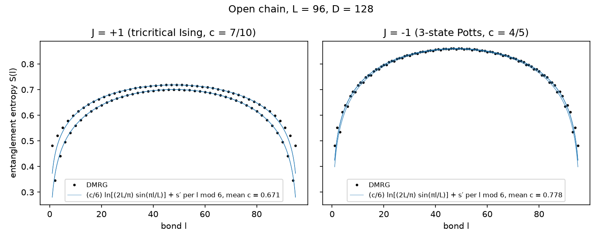
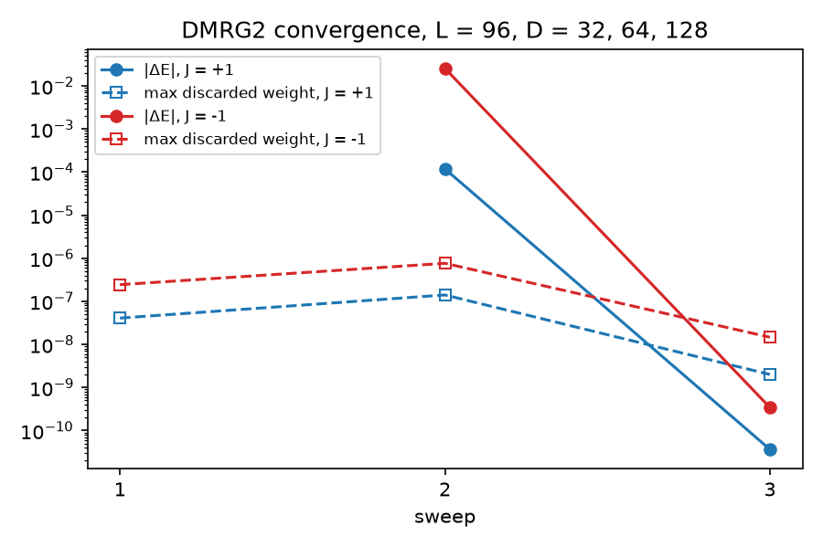
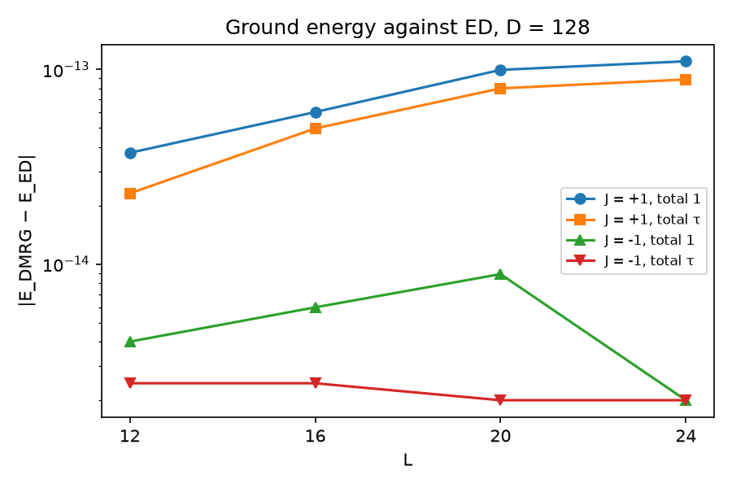

# golden-chain

Two-site DMRG for the Fibonacci golden chain on symtn's anyonic tensors
(`TableRule::fibonacci()`).

## Model

`L` Fibonacci anyons `τ` (`τ ⊗ τ = 1 ⊕ τ`, `d_τ = φ`) on an open chain, in the
fusion-path basis `|x_0 = 1, x_1, …, x_L = total⟩`:

```
H = -J Σ_{i=1}^{L-1} P^(1)_{i,i+1}
```

where `P^(1)` projects neighbouring anyons onto the trivial fusion channel.
In symtn this is the bond term `h ∈ [P, P] ← [P, P]` with block `-J` on the
coupled vacuum and `0` on coupled `τ` (`src/model.rs:bond_term`).

Feiguin et al. (PRL 98, 160409 (2007), p. 3) identify the two critical
points:
- `J = +1` favours the trivial channel. It is the k = 3 RSOS model, the
  tricritical Ising CFT with `c = 7/10`.
- `J = -1` favours the `τ` channel. It is the 3-state Potts CFT with
  `c = 4/5`.

## Algorithm

The algorithmic model is MPSKit 0.13.13's two-site `DMRG2`
(`find_groundstate!(…, ::DMRG2)`); `dmrg::find_groundstate` follows it bond
by bond:
- Lanczos on the two-site `H_eff` (via `symtn::krylov`);
- `svd_compact`, then `find_truncated(Truncation::Rank(D))`, then
  `restrict_leg`, then normalization;
- `ϵ_bond = |1 − |⟨θ_old, u s vh⟩||`, and the eigensolver tolerance follows
  MPSKit's `updatetol`, `clamp(ϵ·10⁻³/√sweep, tol_min, tol_max)`;
- a sweep runs left to right over `1..L-1`, then right to left over `L-2..1`;
  it stops when `max ϵ ≤ tol`.

There is no MPO. The block Hamiltonian and the open bond are kept as
explicit environments (`src/mps.rs`), which is exact for nearest-neighbour
terms. Every numerical constant is a field of `Dmrg2`; there are no defaults.

The tests and the example use MPSKit's default values with one exception:
`tol_max = 1e-12` instead of `1e-4`. At `1e-4`, the second sweep's
eigensolves are already below tolerance at their start vectors and return
them unchanged. The run then stops with `ϵ ≈ 1e-14`, yet the energy is
still above the ED ground energy. With a single-value schedule `D = 128` at
L = 20, `J = -1`, the excess is 2.8e-9 (total 1) and 3.7e-9 (total τ). A ramp
such as 32 → 64 → 128 hides most of the effect (worst 1.9e-10), because
each change of D keeps `ϵ` large for one more sweep.

Convergence is tested only once the last scheduled D is in use, so a run
always reaches the requested bond dimension. Each `SweepLog` records its D.

## Validation

The tests do not trust the tensors under test. `src/ed.rs` is an exact
diagonalization in the fusion-path basis with a closed-form F-symbol and no
symtn dependency.

- **ED oracle.** The ED reproduces TensorKit's 3-anyon matrix to 1e-13 and
  satisfies the Temperley–Lieb relations to 1e-13 (`tests/ed.rs`).
- **Environments and `H_eff`.** At full bond dimension `H_eff` equals the ED
  Hamiltonian to 1e-12. At truncated bonds it is the Galerkin projection of
  the ED Hamiltonian, to 1e-12 under symtn's quantum-dimension-weighted
  `inner` (`tests/heff.rs`).
- **Centre-bond Lanczos.** On `H_eff` it gives the ED ground energy to 1e-10
  for L ≤ 12 (`tests/heff.rs`).
- **DMRG ground energy.** DMRG `E₀` equals ED to 1e-9 for L ∈ {6, 11, 16, 20},
  both `J` and both total charges (`tests/dmrg.rs`). The ED uses a sparse
  Lanczos, which matches dense Jacobi to 1e-11 for L ≤ 12.
- **Schmidt values.** At every bond (L = 9), DMRG's Schmidt values equal ED's
  to 1e-9 in `λ²`. The relation is `λ_{x,k} = σ_{x,k}/√d_x` for a unit ED
  vector, with `Σ_x d_x Σ_k λ² = 1` to 1e-12 (`tests/dmrg.rs`).
- **Central charge** (`tests/central_charge.rs`, `#[ignore]`). Fitted from the
  entanglement profile at L = 96, it must lie within ±0.05 of 7/10 and 4/5.
  This is a physics check, not an exact gate.

## Running

```sh
cargo test --release -p golden-chain                       # all checks, about 10 s
cargo test --release --test central_charge -- --ignored    # central-charge fit, about 90 s
cargo run --release --example golden_chain                 # CSV data in golden-chain/out/
uv run golden-chain/scripts/plot.py                        # figures in golden-chain/docs/figures/
```

## Results

The figures come from `cargo run --release --example golden_chain` and
`uv run golden-chain/scripts/plot.py`, with the `x_L = 1` sector and `D` as
stated in each title.

**Entanglement profile.** The fit is
`S(l) = (c/6) ln[(2L/π) sin(πl/L)] + s′` over `L/8 ≤ l ≤ 7L/8`, one fit per
residue of `l mod 6` (the open chain alternates with bond parity, and the
`J = -1` profile also has period 3), with `c` averaged. The results are
`c ≈ 0.67` for `J = +1` (exact value 7/10) and `c ≈ 0.78` for `J = -1`
(exact value 4/5).



**Convergence.** The plot shows `|ΔE|` between sweeps and the largest
truncation error in each sweep, `√(Σ_c d_c Σ σ²)` over the discarded
Schmidt values, for the D ramp 32 → 64 → 128 at L = 96.
Both runs stop after three sweeps at `max ϵ ≤ 1e-10`.



**Ground energy against ED.** At D = 128 every case agrees with the
sparse-Lanczos ED to ≤ 1.1e-13. That holds for L = 24 (46368 paths) too,
where the centre bond is truncated.



## Performance

Accuracy is checked against the ED (see Validation). MPSKit 0.13.13 is the
reference for speed only. Both sides run the same model and the same
settings: `truncrank(D)`, `tol = 1e-10`, Lanczos with `krylovdim = 30`,
`maxiter = 200`, eager, and the `updatetol` clamp with `tol_max = 1e-12`.
Two differences remain, and every result CSV header records both:
- the Lanczos orthogonalization: krylov's `Cgs2` makes two full passes over
  the basis per step, KrylovKit's `ModifiedGramSchmidt2` makes the
  three-term recurrence plus one pass;
- the initial state: symtn uses right-isometric sites and a seeded random
  first centre; MPSKit uses a seeded random `FiniteMPS`. The initial
  virtual spaces are the same.

The harness is `examples/bench_dmrg.rs` and `bench/mpskit/bench.jl`
(pinned `Project.toml` and `Manifest.toml`), driven one case per process
by `bench/run.sh`, or by `bench/bench.pbs` on an exclusive cluster node.
Each row records the thread settings the process reports, its CPU use and
peak RSS from GNU `time -v`, and its `numactl` binding.
`uv run golden-chain/scripts/plot_bench.py <results dir>` turns the rows
into tables and figures. Three first-result timings are reported. Each is
setup plus the first sweep of the target case:
- a fresh process: for Julia this includes JIT compilation; Rust is
  compiled ahead of time;
- a fresh Julia process started on a sysimage of the bench path
  (`bench/build_sysimage.sh`, PackageCompiler);
- the same process after a one-sweep run of a tiny different case
  (L = 6, D = 8).

### Where the time goes

The case is L = 48, D = 128, J = +1, measured on one Xeon Platinum 9242
node, bound to one 24-core NUMA node. Times are the mean per steady sweep
(sweeps 2-4), in seconds:

| | sweep | eigensolve | of which H_eff | Lanczos vector work | SVD | environments | H_eff applications |
|---|---|---|---|---|---|---|---|
| symtn, 1 thread | 2.28 | 2.05 | 0.34 | 1.71 | 0.16 | 0.06 | 934 |
| MPSKit, 1 thread | 0.72 | 0.37 | 0.25 | 0.12 | 0.18 | 0.18 | 459 |

- **H_eff.** symtn's application is faster per call: 0.37 ms against
  MPSKit's 0.55 ms. Both reduce the nearest-neighbour MPO to the same three
  terms: left operator, bond term, right operator.
- **Lanczos vector work.** symtn's eigensolve time is dominated by the
  Krylov process, not by H_eff: 1.83 ms of vector work per step against
  MPSKit's 0.26 ms. The centre has 11,600 complex entries. On it one symtn
  `inner` takes 28 µs, `axpby` 14 µs and `norm` 28 µs, against 12 µs and
  7 µs for a plain slice pass of the same length. With `Cgs2`'s second full
  pass, symtn therefore does about twice the passes of KrylovKit, each about
  twice as expensive.
- **Sweeps and matvec counts.** symtn converges in three sweeps and MPSKit
  in two from their different initial states. The steady sweeps therefore
  run at different eigensolver tolerances, and symtn does about twice the
  H_eff applications per sweep.
- **Block sizes.** The bulk bond space is `1 ⊕ τ` with degeneracies about
  36 and 56. The two-site centre has exactly two coupled blocks, 56 × 56
  and 92 × 92.

### Threads

At these block sizes more threads do not help either library. Both runs
use the same binding, with BLAS single-threaded on both sides:
- symtn with `dense_threads(16)` and `recoupling_threads(16)` takes
  2.48 s per sweep against 2.28 s at one thread. CPU use is 111 %: the
  runtime pool is entered, but the dominant vector operations run on the
  calling thread.
- MPSKit at `-t 16` takes 0.94 s against 0.72 s, measured with 16 BLAS
  threads.
- With 16 OpenBLAS threads instead, both sides burn about 16 cores
  (1600 % and 790 %) in OpenBLAS's busy-wait and get no speedup. The GEMMs
  are at most about 92³.

Thread scaling is therefore measured on applications with many larger
blocks, not on the golden chain.

## References

- A. Feiguin, S. Trebst, A. W. W. Ludwig, M. Troyer, A. Kitaev, Z. Wang,
  M. H. Freedman, "Interacting anyons in topological quantum liquids: the
  golden chain", Phys. Rev. Lett. 98, 160409 (2007).
- MPSKit.jl 0.13.13 (`DMRG2`, `updatetol`, entropy convention) and
  TensorKit.jl 0.17.1 (semantics and conventions).
